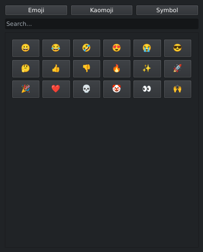
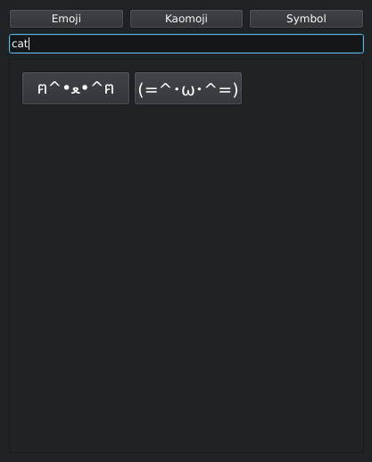

# py-moji-inserter

Lightweight emoji, kaomoji and symbol picker for Linux (Wayland), built with **PySide6**.


-orange.svg)


<p align="center">
    
    
</p>

## Key Features

- Three categories: **Emoji**, **Kaomoji** and **Symbols**.
- Search across characters and their keywords.
- Click an entry and it is pasted straight into the app you were typing in.
- Frameless, always-on-top popup that closes when it loses focus.
- Add your own entries by editing `assets/data.json`.

## How It Works

1. The selected character is copied to the clipboard with `wl-copy`.
2. A `Ctrl+V` key press is simulated with `dotool`.

Because it pastes through the clipboard, it works with any application that accepts pasted text.

## Tech Stack

- **GUI:** PySide6 (Qt6)
- **Clipboard:** wl-clipboard
- **Input simulation:** dotool

## Requirements

- Linux with a Wayland session
- Python 3.10+
- [`wl-clipboard`](https://github.com/bugaevc/wl-clipboard) (provides `wl-copy`)
- [`dotool`](https://sr.ht/~geb/dotool/) (the user needs permission to use `uinput`, see the dotool docs)

## Installation & Usage

1. **Clone the repository:**

   ```bash
   git clone https://github.com/FurkannAli/py-moji-inserter.git
   cd py-moji-inserter
   ```

2. **Install dependencies:**

   ```bash
   pip install -r requirements.txt
   ```

3. **Run the application:**

   ```bash
   python main.py
   ```

### Bind it to a hotkey

The app is meant to be summoned on demand. Bind it in your compositor, for example:

```ini
# Sway
bindsym $mod+period exec python3 /path/to/py-moji-inserter/main.py

# Hyprland
bind = SUPER, period, exec, python3 /path/to/py-moji-inserter/main.py
```

## Adding Your Own Entries

Entries live in `assets/data.json`. Each one has the character itself and a list of search keywords (keep keywords lowercase):

```json
{
  "kaomoji": [
    { "char": "(╯°□°)╯︵ ┻━┻", "keywords": ["table", "flip", "angry"] },
    { "char": "(๑>◡<๑)", "keywords": ["cute", "happy", "excited", "smile"] }
  ]
}
```

## Status

This project is a work in progress. Planned improvements:

- [ ] Recently used section
- [ ] Packaged release
- [ ] Support for X11 (`xclip` / `xdotool`)
- [ ] Generally improved enough for daily usage😭

## License

Distributed under the MIT License.
